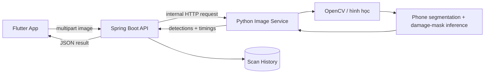

# Industrial Defect Image Retrieval

Hệ thống phát hiện lỗi ngoại quan trên thiết bị điện tử bằng xử lý ảnh và AI.

## Kiến trúc

- `image-processing/`: xử lý ảnh, enhancement, phone segmentation, damage-mask inference và đo thời gian.
- `backend/`: API Spring Boot, validation, điều phối inference và lưu lịch sử.
- `app/`: Flutter UI, upload/camera, hiển thị source/overlay-mask và lịch sử quét.
- `contracts/`: hợp đồng dữ liệu dùng chung giữa ba thành phần.
- `docs/`: thiết kế hệ thống và tài liệu thực nghiệm.

## Trạng thái

Phase 1 đã xác định pipeline tổng thể, ranh giới trách nhiệm và hợp đồng kết quả phát hiện. Xem [tài liệu Phase 1](docs/phase-01-overall-pipeline.md).

Phase 2 đã cài đặt Perspective Correction trên Python/OpenCV, kèm CLI, ảnh before/after, timing và unit test. Xem [tài liệu Phase 2](docs/phase-02-perspective-correction.md).

Phase 3 đã cài đặt Illumination Correction với Gamma, CLAHE, background estimation và chế độ kết hợp. Xem [tài liệu Phase 3](docs/phase-03-illumination-correction.md).

Phase 4 đã cài đặt Color Space Transformation (BGR, RGB, Gray, HSV, LAB), trích xuất kênh, tính toán tương phản (Weber, Michelson, CNR) và sinh ảnh so sánh. Xem [tài liệu Phase 4](docs/phase-04-color-space.md).

Phase 5 đã cài đặt Data Augmentation cho thiết bị điện tử, đồng bộ tọa độ Bounding Box YOLO (Flip, Rotation, Brightness, Noise, Blur) và export nhãn YOLO. Xem [tài liệu Phase 5](docs/phase-05-image-augmentation.md).

Phase 6 đã cài đặt Before & After Comparison Suite với bộ chỉ số định lượng (CNR, Tenengrad, Laplacian Var, Entropy, Noise Amplification) và bảng so sánh trực quan. Xem [tài liệu Phase 6](docs/phase-06-before-after-comparison.md).

Phase 7 đã thiết lập YOLO baseline pipeline: adapter Ultralytics, mock detector, postprocess bounding box, ảnh annotated và timing theo contract. Đây là baseline/CLI độc lập, không phải luồng runtime hiện tại. Xem [tài liệu Phase 7](docs/phase-07-yolo-baseline.md).

Luồng runtime hiện tại dùng worker phone damage v3: RF-DETR segmentation xác định vùng điện thoại, sau đó mô hình damage tạo mask ứng viên trên ảnh gốc; backend lưu kết quả và Flutter hiển thị overlay. Chi tiết tại [phone damage v3](docs/PHONE_DAMAGE_V3.md). Worker hiện trả `detections=[]`; vì vậy UI runtime chưa hiển thị bounding box/class/confidence kiểu YOLO.

Kiến trúc runtime chính thức là **damage-mask segmentation**. Việc còn lại là đánh giá trên test set độc lập bằng metric segmentation phù hợp (IoU, Dice, pixel/image-level precision-recall), calibration ngưỡng và benchmark thời gian trên máy đích. YOLO chỉ được giữ lại như baseline/CLI nghiên cứu, không phải một phần của demo runtime.

Xem [quyết định kiến trúc segmentation](docs/SEGMENTATION_RUNTIME.md) để biết chính xác dữ liệu mà app được phép hiển thị, metric cần đánh giá và giới hạn hiện tại.

Hướng dẫn cài đặt, chạy test và demo từ clone mới: [SETUP_AND_RUN.md](docs/SETUP_AND_RUN.md).

