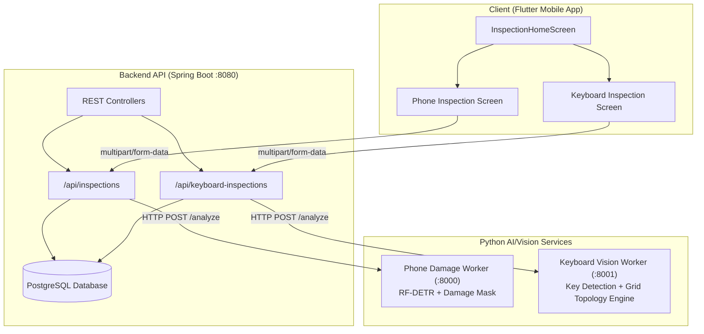

# Industrial Defect Image Retrieval

Hệ thống phát hiện lỗi ngoại quan trên thiết bị điện tử bằng xử lý ảnh và AI (hỗ trợ kiểm tra ngoại quan điện thoại và bàn phím).

## Kiến trúc Hệ thống

Hệ thống được thiết kế theo kiến trúc 3 tầng phân tán, tách biệt độc lập giữa module kiểm tra điện thoại và module kiểm tra bàn phím:

- `image-processing/`: Xử lý ảnh, enhancement, phone segmentation, damage-mask inference và keyboard vision worker.
- `backend/`: API Spring Boot, validation, điều phối inference giữa các worker và lưu trữ lịch sử quét.
- `app/`: Ứng dụng Flutter UI, upload/chụp ảnh, hiển thị overlay trực quan và lịch sử kiểm tra.
- `contracts/`: Hợp đồng JSON Schema dùng chung giữa các thành phần (`contracts/keyboard-inspection-result.schema.json`).
- `docs/`: Tài liệu thiết kế hệ thống, nghiên cứu thực nghiệm và dataset card.

---

## 1. Module Kiểm tra Ngoại quan Điện thoại (Phone Defect Inspection)

Đã hoàn thành các phase nghiên cứu và tích hợp runtime:
- **Phase 1**: Pipeline tổng thể và ranh giới trách nhiệm ([docs/phase-01-overall-pipeline.md](docs/phase-01-overall-pipeline.md)).
- **Phase 2**: Perspective Correction với OpenCV ([docs/phase-02-perspective-correction.md](docs/phase-02-perspective-correction.md)).
- **Phase 3**: Illumination Correction (Gamma, CLAHE, Background Estimation) ([docs/phase-03-illumination-correction.md](docs/phase-03-illumination-correction.md)).
- **Phase 4**: Color Space Transformation & Contrast Metrics (CNR, Weber, Michelson) ([docs/phase-04-color-space.md](docs/phase-04-color-space.md)).
- **Phase 5**: Data Augmentation đồng bộ Bounding Box YOLO ([docs/phase-05-image-augmentation.md](docs/phase-05-image-augmentation.md)).
- **Phase 6**: Before & After Comparison Suite ([docs/phase-06-before-after-comparison.md](docs/phase-06-before-after-comparison.md)).
- **Phase 7**: YOLO baseline pipeline ([docs/phase-07-yolo-baseline.md](docs/phase-07-yolo-baseline.md)).
- **Runtime v3**: Kiến trúc chính thức **damage-mask segmentation** (RF-DETR segmentation vùng điện thoại + mô hình damage tạo mask ứng viên trên ảnh gốc). Chi tiết tại [phone damage v3](docs/PHONE_DAMAGE_V3.md) và [quyết định kiến trúc segmentation](docs/SEGMENTATION_RUNTIME.md).

---

## 2. Module Kiểm tra Ngoại quan Bàn phím (Keyboard Defect & Layout Inspection)

Tiếp nối module kiểm tra điện thoại, module bàn phím tập trung giải quyết các bài toán lỗi hình học và lỗi bề mặt đặc thù trên linh kiện bàn phím máy tính/laptop:

### Mục tiêu chức năng
1. **Phát hiện lỗi phím (`defective_key` / `damaged_keycap`)**: Phát hiện các khuyết tật vật lý trên bề mặt keycap như nứt, vỡ, trầy xước, biến dạng, mòn ký tự.
2. **Phát hiện mất phím / thiếu phím (`missing_key`)**: Xác định các vị trí switch bị trống do rơi hoặc thiếu lắp ráp keycap.
3. **Phát hiện sai vị trí & lệch phím (`shifted_key`, `tilted_key`, `misplaced_key`)**:
   - *Lệch hình học*: Phím bị kênh, xiên góc (`tilted_key`), hoặc bị xô lệch khỏi tâm bước lưới (`shifted_key`).
   - *Sai vị trí ký tự*: Phím bị lắp nhầm vị trí so với layout quy chuẩn (`wrong_keycap` / `misplaced_key`).
4. **Nhận diện và đối soát Layout (`layout_validation`)**: Tự động nhận diện cấu hình bàn phím (ANSI 104, ANSI 87 TKL, ISO 105, 60%, 65%, 75%, Laptop) dựa trên số hàng phím, số lượng phím và hình dạng/kích thước phím chức năng (Enter, Space, Shift).

### Kiến trúc Hybrid: Deep Learning + Grid Topology Engine
Để đạt độ tin cậy và khả năng mở rộng tối đa, hệ thống áp dụng kiến trúc phối hợp:
- **Tầng 1 - Deep Learning Object Detection (YOLO / Vision Model)**: Chịu trách nhiệm phát hiện sự hiện diện của phím (`key`) và các bất thường bề mặt (`defective_key` / `damaged_keycap`).
- **Tầng 2 - Grid & Layout Topology Engine (OpenCV / Rule-based Heuristic)**: Phân tích cấu trúc lưới hàng/cột, đo khoảng cách hình học, phát hiện khoảng trống (`missing_key`), đo độ xiên lệch (`shifted_key`, `tilted_key`) và đối chiếu layout với template chuẩn.

Chi tiết về kiến trúc, quyết định triển khai, dataset và tiến trình nghiên cứu xem tại:
- [Quyết định kiến trúc & triển khai runtime bàn phím](docs/KEYBOARD_RUNTIME.md)
- [Báo cáo tiến trình và tích hợp mô hình](docs/KEYBOARD_DETECTION_PROGRESS.md)
- [Tài liệu hướng dẫn kiểm tra bàn phím](docs/KEYBOARD_INSPECTION.md)
- [Dataset Card bàn phím](datasets/keyboard/DATASET_CARD.md)
- [Tài liệu chuẩn bị dữ liệu và huấn luyện](docs/KEYBOARD_DATA_AND_TRAINING.md)

---

## Hướng dẫn cài đặt và chạy
Xem hướng dẫn chi tiết tại [SETUP_AND_RUN.md](docs/SETUP_AND_RUN.md).

