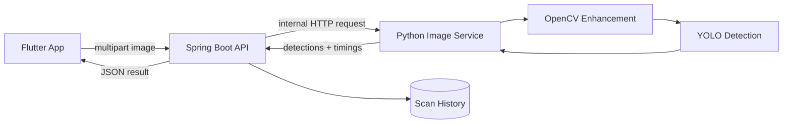

# Industrial Defect Image Retrieval

Hệ thống phát hiện lỗi ngoại quan trên thiết bị điện tử bằng xử lý ảnh và AI.

## Kiến trúc

- `image-processing/`: xử lý ảnh, enhancement, YOLO inference và đo thời gian.
- `backend/`: API Spring Boot, validation, điều phối inference và lưu lịch sử.
- `app/`: Flutter UI, upload/camera, hiển thị bounding box và lịch sử quét.
- `contracts/`: hợp đồng dữ liệu dùng chung giữa ba thành phần.
- `docs/`: thiết kế hệ thống và tài liệu thực nghiệm.

## Trạng thái

Phase 1 đã xác định pipeline tổng thể, ranh giới trách nhiệm và hợp đồng kết quả phát hiện. Xem [tài liệu Phase 1](docs/phase-01-overall-pipeline.md).

Phase tiếp theo: Perspective Correction trên Python/OpenCV, kèm ảnh before/after và đánh giá ảnh hưởng đến detection.
