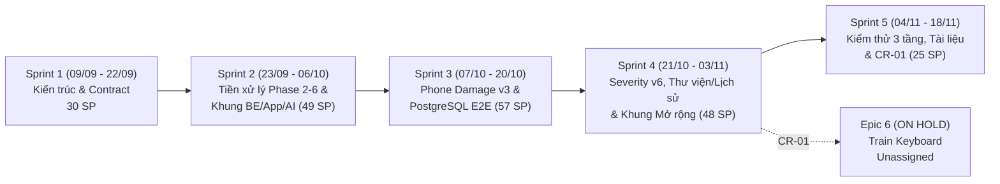

# Quy Trình Quản Lý Dự Án Trên Jira & Phân Công 5 Phần (`IDIR`)

Tài liệu này cung cấp ngữ cảnh thống nhất cho cả nhóm 5 thành viên về cách vận hành dự án **Industrial Defect Image Retrieval (`IDIR`)** trên **Jira Cloud**, phân chia công việc, mốc thời gian 5 Sprint và quy tắc phối hợp để mỗi thành viên chủ động quản lý phần việc của riêng mình.

---

## 1. Phạm Vi Quản Trị & Quyết Định `CR-01`

- **Phạm vi triển khai chính (`Sprint 1` → `Sprint 5` — `09/09/2026` đến `18/11/2026`):**
  - Toàn bộ hệ thống **Kiểm tra lỗi ngoại quan Điện thoại (Phone Defect Inspection)**: 3 tầng Flutter – Spring Boot (:8080) – Python Worker (:8000, RF-DETR + Phone Damage v3), tiền xử lý Phases 2–6, nới khung v1/v2, Severity v1–v6, Nhập ảnh thư viện, Lưu ảnh về máy, Lịch sử quét thật trên PostgreSQL 17 và kiểm thử E2E 3 tầng (146 Python + 4 Java + 41 Flutter tests).
  - Khung hạ tầng mở rộng cho bàn phím *(chỉ gồm Contract, DB Flyway V5, khung API và khung UI — không bao gồm huấn luyện AI)*.
- **Hạng mục tạm ngưng phân công (`Change Request CR-01` — `Epic 6` / `ON HOLD`):**
  - Toàn bộ khối **Train Keyboard** (chuẩn bị & lọc dataset training bàn phím, auto-label & chỉnh nhãn trên Annotation Studio, train YOLO11n Stage 1/2, Hungarian Matching & OCR) được đặt ở trạng thái **`On Hold`**, **`Unassigned`** và **không đưa vào Sprint 1–5**.
  - Khi hoàn tất bàn giao module Điện thoại, nhóm mới mở lại Epic 6 trong Sprint 6+.

---

## 2. Phân Chia Công Việc Thành 5 Phần (`TV1` – `TV5`)

| Phần | Vai trò | Phạm vi sở hữu trong Repository | Số Issue | Story Points |
| :---: | :--- | :--- | :---: | :---: |
| **`TV1`** | **Image Processing & Evaluation Engineer** | `preprocessing/`, `model/`, `defect_vision/{perspective, illumination, colorspace, augmentation, comparison, preprocess_benchmark}.py`, `scripts/{audit_dataset, validate_manifest, smoke_tv1_decode}.py` | 8 | 36 SP |
| **`TV2`** | **AI/CV Engineer (Phone Defect)** | `phone_damage_v3_kit/`, `defect_vision/{phone_segmenter, corner_expansion, surface_geometry, damage_severity, damage_service, damage_api, yolo_baseline}.py`, `severity.v1..v6.json`, `corner_expansion.v1..v2.json` | 9 | 49 SP |
| **`TV3`** | **Backend & DevOps Engineer** | `contracts/`, `docker-compose.yml`, `docker/postgres/`, `backend/` (Spring Boot :8080, Flyway `V1`–`V5`) | 9 | 44 SP |
| **`TV4`** | **Mobile Frontend Engineer (Flutter)** | `app/` (Theme, Camera 2 mặt, Overlay Mask, Lưới 3×3, Thư viện, Lưu ảnh MediaStore, Lịch sử phân trang, khung UI bàn phím) | 7 | 40 SP |
| **`TV5`** | **PM / Scrum Master & QA Engineer** | Quản trị Jira, `image-processing/scripts/verify_*.py`, kiểm thử E2E 3 tầng + 5 Failure Cases, `docs/*.md`, `README.md` | 12 | 40 SP |
| **Tổng** | **5 phần Active (`Sprint 1`–`5`)** | *(Ngoài ra có 4 Story thuộc Epic 6 ở trạng thái `On Hold`, `Unassigned`)* | **45** | **209 SP** |

---

## 3. Lộ Trình 5 Sprints (Khớp Lịch Sử Git Thực Tế)



| Sprint | Thời gian | Mục tiêu chính (Sprint Goal) | Mốc GitHub tham chiếu |
| :---: | :---: | :--- | :--- |
| **Sprint 1** | `09/09 – 22/09/2026` | Chốt kiến trúc 3 tầng, JSON Schema contract, môi trường Docker/Flutter & Jira | `7c6b959`, `d11f02c` |
| **Sprint 2** | `23/09 – 06/10/2026` | Hoàn thiện OpenCV Phases 2–6, YOLO baseline, RF-DETR body mask, khung BE & Camera Flutter | `244e175`, `13be1e1`, `85e894a` |
| **Sprint 3** | `07/10 – 20/10/2026` | Đóng gói Phone Damage v3, Python Worker :8000, BE API + PostgreSQL E2E & Corner v1 | PR `#1`, `#2`, `73f224e`, `427b1c7` |
| **Sprint 4** | `21/10 – 03/11/2026` | Severity v6, Corner v2, ảnh thiếu phần, Nhập thư viện/Lưu ảnh/Lịch sử thật & khung mở rộng | PR `#4`, `e487599`, `53b7765` |
| **Sprint 5** | `04/11 – 18/11/2026` | Kiểm thử 146 Python + 4 Java + 41 Flutter, demo 5 Failure Cases, tài liệu & chốt CR-01 | Hoàn thiện & bàn giao |

---

## 4. Luồng Thao Tác Chuẩn Trên Jira Cho Cả Nhóm

Để bảng Jira vừa chuẩn chuyên nghiệp, vừa thể hiện đúng đóng góp thật của từng tài khoản thành viên, cả nhóm thống nhất **4 nguyên tắc**:

1. **Mỗi thành viên dùng tài khoản Jira của chính mình (không thao tác hộ phần người khác):**
   - PM (`TV5`) tạo khung Project Scrum (`IDIR`), mời đủ 5 email vào Project và khởi tạo sẵn **6 Epics, 5 Sprints, 45 Active Issues (trạng thái `To Do`) + 4 On-Hold Issues** kèm sẵn **116 GitHub Web Links**.
   - **Từng thành viên (`TV1`–`TV5`)** chỉ thao tác trên **các thẻ được gán cho chính mình**: kéo qua `In Progress` → `In Review` → `Done` và bình luận xác nhận kết quả/bằng chứng.
2. **Không sửa/làm giả lịch sử Git cũ (`rebase` / `force push`):**
   - Toàn bộ commit/PR đã hoàn thành trước khi dùng Jira được liên kết minh bạch qua **Jira Web Links** (có icon GitHub trỏ thẳng tới commit/PR/file thật).
   - Các commit mới từ thời điểm này trở đi gắn mã thẻ Jira ở đầu commit hoặc tên nhánh (ví dụ `IDIR-43: update docs`) để app **GitHub for Jira** tự động đồng bộ vào khung *Development*.
3. **Chạy lần lượt từng Sprint để Velocity Chart chính xác:**
   - PM bấm **Start Sprint 1** (nhập đúng ngày `09/09/2026` – `22/09/2026`) → 5 thành viên hoàn thành thẻ Sprint 1 của riêng mình → PM bấm **Complete Sprint 1**.
   - Lặp lại tương tự cho Sprint 2, 3, 4, 5.
4. **Giữ nguyên Epic 6 (Train Keyboard) ở trạng thái `On Hold`:**
   - Không gán người thực hiện (`Unassigned`), không kéo vào Sprint 1–5 và không đánh dấu `Done`.

---

## 5. Công Cụ Hỗ Trợ Tự Động Hóa (`tools/jira/`)

Nhóm đã tích hợp sẵn bộ công cụ tại [`tools/jira/`](../tools/jira/README.md) sử dụng Jira Cloud REST API chính thức:

- **Khởi tạo toàn bộ khung dự án (dành cho PM):**
  ```powershell
  python tools/jira/sync_jira_project.py --check-connection
  python tools/jira/sync_jira_project.py --dry-run
  python tools/jira/sync_jira_project.py
  ```
- **Chế độ chỉ thao tác phần của riêng mình (không đụng thẻ người khác):**
  - Chỉ đồng bộ/tạo các thẻ thuộc vai trò của bạn (ví dụ `TV2`):
    ```powershell
    python tools/jira/sync_jira_project.py --only-role TV2
    ```
  - Chỉ cập nhật tiến độ & bình luận bằng chứng cho **chính các thẻ được gán cho tài khoản của bạn** trong một Sprint cụ thể (ví dụ `TV2` ở Sprint 1):
    ```powershell
    python tools/jira/sync_jira_project.py --complete-my-tasks --only-role TV2 --sprint S1
    ```
    *(Script tự kiểm tra `assignee == tài khoản đang đăng nhập` và tuyệt đối bỏ qua mọi thẻ của thành viên khác).*

Chi tiết cấu hình `.env.jira` và hướng dẫn từng bước xem tại [`tools/jira/README.md`](../tools/jira/README.md).
