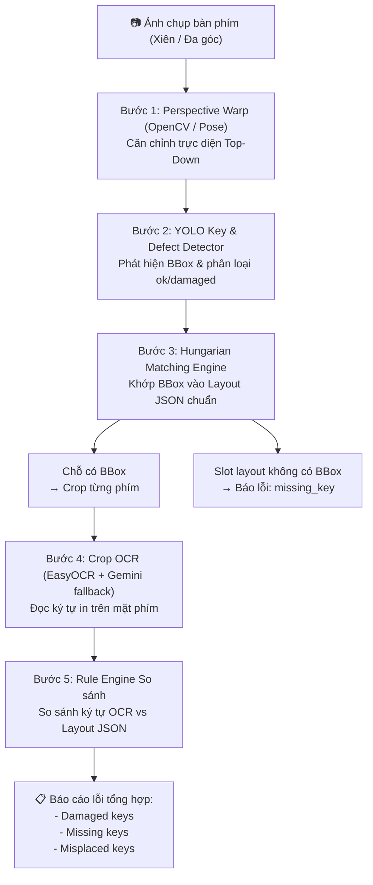

# ⌨️ Báo Cáo Tiến Trình & Hướng Dẫn Tích Hợp: Module Keyboard Defect Detection

Tài liệu này ghi nhận toàn bộ tiến trình nghiên cứu, dữ liệu, trọng số mô hình và công cụ hỗ trợ cho chức năng **Kiểm tra Ngoại quan Bàn phím (Keyboard Defect Detection)** trên nhánh `train/keyboard_name`.

---

## 1. Kiến trúc Hệ thống & Ranh giới Module

Module bàn phím giải quyết 3 nhóm lỗi ngoại quan trọng tâm:
1. **Phím hư hại (`damaged_key` / `defective_key`):** Phím nứt, vỡ, sứt mẻ, cong vênh, mòn nặng ký tự.
2. **Mất phím / thiếu phím (`missing_key`):** Vùng khuyết keycap (lộ chân switch hoặc núm màng cao su).
3. **Sai vị trí phím (`misplaced_key` / `wrong_keycap`):** Phím bị lắp nhầm vị trí so với layout chuẩn quy ước.



---

## 2. Tổ chức Thư mục & Tài nguyên trong Repository

Toàn bộ tài nguyên liên quan đã được tích hợp gọn gàng vào dự án:

```text
D:/QLDAPM/QLDAPM_Industrial_Defect_Image_Retrieval/
├── datasets/keyboard/
│   ├── training_dataset/
│   │   ├── processed/                       <-- 533 ảnh sạch từ keys_v6 (21.271 phím, 1 class 'key')
│   │   ├── processed_v7_autolabeled/
│   │   │   ├── multi_class/                 <-- 402 ảnh sạch độc nhất (31.794 key_ok, 1.166 key_damaged)
│   │   │   └── stage1_merged/               <-- 402 ảnh đưa về 1 class 'key'
│   │   ├── raw_extracted/                   <-- Dữ liệu gốc trước khi xử lý
│   │   ├── deleted/                         <-- Chứa 708 ảnh trùng lặp / ảnh đã xóa qua Web Tool
│   │   └── data.yaml                        <-- Cấu hình YOLO cho Stage 1
│   ├── DATASET_CARD.md
│   └── README.md
│
├── image-processing/
│   ├── models/
│   │   └── keyboard_yolo11n_keys_v1.pt      <-- Checkpoint tốt nhất (Recall 98.4%, mAP50 98.9%)
│   └── keyboard_vision/
│       ├── runs/stage1_key_detector/        <-- Toàn bộ log huấn luyện, loss curve, confusion matrix
│       ├── config.py
│       ├── keyboard_api.py
│       └── pipeline.py
│
├── scripts/keyboard/
│   ├── train_stage1.py                      <-- Script huấn luyện YOLO11n Stage 1
│   ├── eval_key_count.py                    <-- Script đo tỷ lệ phím detect / tổng phím thật
│   ├── autolabel_v7.py                      <-- Script dùng Stage 1 auto-label phím lành cho v7
│   ├── relabel_first50.py                   <-- Script gán nhãn TTA siêu nhạy cho ảnh khó
│   ├── deduplicate_dataset.py               <-- Script lọc và chuyển ảnh trùng sang 'deleted'
│   └── swap_keys.py                         <-- Script hoán đổi vị trí phím (tạo synthetic test set)
│
└── tools/keyboard_annotation_studio/        <-- Web Tool Local kiểm tra & sửa nhãn
    ├── server.py                            <-- Flask server (Port 5050)
    ├── templates/index.html
    ├── static/app.js
    └── start_annotation_studio.ps1          <-- Script khởi động nhanh 1-click
```

---

## 3. Trọng số Mô hình & Kết quả Huấn luyện

Mô hình **YOLO11n Stage 1** đã hoàn thành 25 epochs huấn luyện:
- **Đường dẫn trọng số:** `image-processing/models/keyboard_yolo11n_keys_v1.pt`
- **Tập đánh giá:** 104 ảnh test (4.203 phím)
- **Chỉ số đạt được:**
  - **Recall:** **98.4%** (Đảm bảo tìm thấy hầu như mọi phím, không bị sót)
  - **mAP50:** **98.9%**
  - **Precision:** **97.4%**
  - **mAP50-95:** **71.5%**

---

## 4. Công cụ Kiểm tra & Hiệu chỉnh: Keyboard Annotation Studio

Hệ thống cung cấp sẵn một Web Tool cục bộ để kiểm tra trực quan các bounding box mà AI đã gán nhãn:

### Cách khởi động:
Chạy script PowerShell:
```powershell
.\tools\keyboard_annotation_studio\start_annotation_studio.ps1
```
Hoặc chạy trực tiếp bằng Python:
```bash
python tools/keyboard_annotation_studio/server.py
```
Truy cập trên trình duyệt: **`http://localhost:5050`**

### Tính năng chính:
- **Hiển thị màu sắc trực quan:**
  - 🟢 **Xanh lá (`key_ok`):** Phím bình thường.
  - 🔴 **Đỏ (`key_damaged`):** Phím hư hại bề mặt.
  - 🟡 **Vàng (`key_missing`):** Vị trí mất phím.
- **Hiệu chỉnh thủ công:**
  - Bấm phím **`1` / `2` / `3`**: Đổi nhãn box đang chọn.
  - Phím **`R`**: Kéo chuột vẽ thêm bounding box mới.
  - Phím **`V`**: Chọn box để di chuyển / căn chỉnh lại kích thước.
  - Phím **`Del`**: Xóa box AI bắt nhầm.
  - Phím **`Ctrl + S`**: Lưu trực tiếp vào file nhãn `.txt` trên ổ cứng.
  - Phím **`Shift + Delete`**: Di chuyển ảnh mờ / trùng lặp vào thư mục `datasets/keyboard/training_dataset/deleted/`.
  - Phím **`A` / `D`**: Lùi / Tiến ảnh kế tiếp.

---

## 5. Các bước triển khai tiếp theo (Next Steps)

1. **Task 1 (Perspective Warp):** Hoàn thiện module tự động phát hiện 4 góc bàn phím để nắn phẳng ảnh chụp điện thoại góc nghiêng.
2. **Task 2 (Train 3-Class Detector):** Huấn luyện mô hình YOLO nhận diện đồng thời `key_ok`, `key_damaged`, `key_missing` trên tập dữ liệu đã lọc sạch.
3. **Task 3 (Hungarian Matching):** Tích hợp thuật toán Hungarian vào `image-processing/keyboard_vision/pipeline.py` để ghép cặp tọa độ phát hiện với file template `layout.json`.
4. **Task 4 (Crop OCR & Rule Engine):** Tích hợp EasyOCR đọc chữ trên keycap crop và đối chiếu với template để kết luận lỗi `misplaced_key`.
