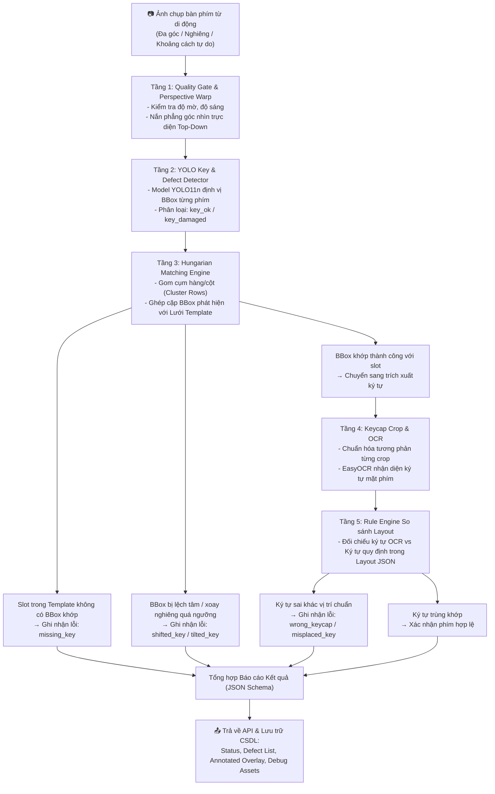

# Kiến trúc runtime & Quyết định triển khai: Keyboard Defect Detection

Tài liệu này ghi nhận chính thức các **quyết định kiến trúc (Architecture Decision Records - ADR)**, chiến lược kỹ thuật, luồng dữ liệu và ranh giới trách nhiệm của tính năng **Kiểm tra Lỗi Ngoại quan Bàn phím (Keyboard Defect & Layout Inspection)** trong dự án.

---

## 1. Quyết định Cốt lõi (Core Decisions)

1. **Độc lập vi dịch vụ (Service Isolation):**
   - Triển khai worker bàn phím thành một dịch vụ hoàn toàn riêng biệt chạy trên tiến trình Python độc lập tại cổng `8001` (`KEYBOARD_SERVICE_URL`).
   - Tách biệt hoàn toàn với Phone Damage worker (cổng `8000`), không dùng chung code model hay import chéo giữa `keyboard_vision` và `defect_vision`. Spring Boot đóng vai trò API Gateway tiếp nhận và điều phối.

2. **Kiến trúc Phối hợp Phân tầng (Hybrid Multi-Stage Architecture):**
   - **Không sử dụng một mô hình Deep Learning đơn lẻ** để cố gắng giải quyết toàn bộ các bài toán logic toàn cục phức tạp (như "vị trí bị thiếu phím" hay "phím Q bị lắp nhầm vào vị trí phím W").
   - Kết hợp giữa **Deep Learning (YOLO11n)** cho tác vụ nhận diện vật thể/bề mặt với **Thuật toán Hình học (Grid Topology / Hungarian Matching)** và **OCR Rule Engine** cho tác vụ cấu trúc và layout.

3. **Chiến lược Huấn luyện 2 Giai đoạn (Two-Stage Training & Human-in-the-Loop):**
   - **Giai đoạn 1 (Stage 1):** Huấn luyện mô hình YOLO11n đơn lớp (`key`) với độ nhạy cực cao (đạt **Recall 98.4%**, **mAP50 98.9%**) nhằm đảm bảo tìm thấy mọi phím, không bỏ sót.
   - **Giai đoạn 2 (Stage 2):** Sử dụng Stage 1 để auto-labeling tập dữ liệu lớn kết hợp TTA (Test-Time Augmentation), sau đó đưa qua công cụ nội bộ **Keyboard Annotation Studio** để chuyên viên thẩm định và chỉnh sửa nhãn 3 class (`key_ok`, `key_damaged`, `key_missing`) trước khi huấn luyện mô hình đa lớp chính thức.

4. **Chuẩn hóa Hợp đồng Dữ liệu nghiêm ngặt (Strict Contract-First):**
   - Toàn bộ giao tiếp giữa Mobile (Flutter), Backend (Spring Boot) và Python Worker phải tuân thủ nghiêm ngặt JSON Schema tại `contracts/keyboard-inspection-result.schema.json`.
   - Cơ sở dữ liệu lưu trữ lịch sử qua hai bảng chuyên biệt `keyboard_inspections` và `keyboard_defects` (migration `V5__add_keyboard_inspections.sql`).

5. **Nguyên tắc Chứng cứ Rõ ràng (Evidence-Gated Decision):**
   - Hệ thống chỉ kết luận lỗi khi ảnh thỏa mãn chất lượng (độ sắc nét Laplacian, độ sáng, không cháy sáng) và phát hiện đủ số lượng phím/hàng tối thiểu. Nếu không đủ điều kiện, hệ thống bắt buộc chuyển trạng thái sang `insufficient_evidence` kèm mảng `reasons` giải thích rõ ràng và yêu cầu kiểm tra thủ công.
   - Giới hạn phạm vi: Chỉ kết luận lỗi ngoại quan bề mặt và hình học; **tuyệt đối không kết luận hoặc suy đoán** về switch cơ học, mạch điện tử, pin, Bluetooth/USB hay firmware.

---

## 2. Bối cảnh & Lý giải Kiến trúc (Context & Rationale)

### Thách thức bài toán
Bàn phím cơ/laptop mang các đặc thù công nghiệp phức tạp:
- **Cấu trúc dạng lưới lặp lại (Dense Grid Structure):** Các phím nằm san sát nhau, rất dễ bị gộp box hoặc nhận diện nhầm khi chụp từ camera góc nghiêng.
- **Kích thước đa dạng (Keycap Units):** Các phím chữ (1u), phím modifier (1.25u, 1.5u, 2u, 2.25u) và thanh Spacebar (6.25u/7u) có kích thước rất khác nhau.
- **Đa dạng layout:** ANSI-104 (Fullsize), ANSI-87 (TKL), 60%, 65%, 75%, ISO-105, Laptop layout.
- **Mặt phím ký tự:** Phím bị cắm lộn vị trí (ví dụ đổi chỗ phím E và phím R) không thể phát hiện nếu chỉ dựa vào bounding box hình học mà không đọc ký tự in trên mặt phím.

### So sánh các phương án tiếp cận

| Tiêu chí | Phương án 1: Pure Deep Learning (Single Model) | Phương án 2: Pure Classical CV (OpenCV Heuristic) | Phương án 3: Hybrid Architecture (Quyết định lựa chọn) |
| :--- | :--- | :--- | :--- |
| **Bản chất** | Một model YOLO detect tất cả: phím tốt, phím hỏng, phím mất, phím sai chỗ. | Dùng thresholding, contour và khoảng cách hình học hoàn toàn. | YOLO detect phím & lỗi bề mặt + Hungarian Matching + Crop OCR + Rule Engine. |
| **Khả năng bắt phím mất** | Kém: Mô hình object detection rất khó học "khoảng trống không có phím" trong điều kiện ánh sáng thay đổi. | Khá: Dựa vào khoảng cách bước lưới nhưng dễ lỗi nếu phím xiên góc. | **Xuất sắc:** Đối chiếu slot còn trống trong layout template chuẩn qua Hungarian Matching. |
| **Phát hiện phím sai vị trí** | Bất khả thi nếu không đọc được chữ. | Bất khả thi. | **Khả thi:** Crop từng keycap đưa qua OCR đọc ký tự và đối soát trực tiếp với layout JSON. |
| **Độ nhạy khuyết tật bề mặt** | Tốt nếu có nhiều dữ liệu gán nhãn chi tiết. | Rất kém: Dễ nhầm vân ký tự với vết nứt/trầy xước. | **Rất tốt:** Tận dụng khả năng trích xuất đặc trưng sâu của YOLO. |
| **Khả năng giải thích (Explainability)** | Hộp đen (Black-box). | Cao nhưng mong manh với nhiễu. | **Rõ ràng, minh bạch:** Báo cáo chi tiết từng hàng, cột, tọa độ và lý do lỗi. |

---

## 3. Luồng Xử lý Chi tiết (Hybrid Processing Pipeline)



---

## 4. Phân loại Lỗi & Ranh giới Trách nhiệm (Defect Taxonomy & Matrix)

| Nhóm lỗi | Tên loại lỗi trong Contract | Trách nhiệm phát hiện | Tiêu chí kỹ thuật kết luận | Mức độ nghiêm trọng (`severity`) |
| :--- | :--- | :--- | :--- | :--- |
| **Hư hại bề mặt** | `damaged_keycap` | YOLO Defect Detector | BBox phát hiện nứt vỡ, mẻ góc, mòn phím với `confidence >= 0.5`. | `moderate` / `severe` |
| **Mất phím / Khuyết phím** | `missing_key` | Hungarian Matching / Geometry Engine | Vị trí slot trong template không tìm thấy phím tương ứng (khoảng cách bước lưới `gap > 1.4 * median_gap`). | `moderate` |
| **Lệch hình học: Nghiêng** | `tilted_key` | Contour / Minimum Area Rect | Góc nghiêng của keycap lệch so với trung vị góc hàng `abs(angle - median_angle) > 6°`. | `minor` |
| **Lệch hình học: Lệch tâm** | `shifted_key` | Grid Analysis Heuristic | Tọa độ tâm phím lệch khỏi vị trí bước lưới dự kiến `> 0.35 * median_gap`. | `minor` |
| **Sai vị trí phím** | `wrong_keycap` | Crop OCR & Rule Matcher | Ký tự nhận diện khác ký tự quy ước của slot trong layout template (với độ tương đồng OCR `< 0.6`). | `minor` / `moderate` |
| **Không xác định** | `uncertain` | Quality Gate / Uncertainty Handler | Bằng chứng hình học hoặc bề mặt có bất thường nhưng không đủ tin cậy để phân loại cụ thể. | `unknown` |

---

## 5. Chiến lược Dữ liệu & Huấn luyện (Data & Training Strategy)

```text
datasets/keyboard/
├── training_dataset/
│   ├── processed/                       <-- 533 ảnh sạch từ keys_v6 (21.271 phím, 1 class 'key')
│   ├── processed_v7_autolabeled/
│   │   ├── multi_class/                 <-- 402 ảnh sạch độc nhất (31.794 key_ok, 1.166 key_damaged)
│   │   └── stage1_merged/               <-- 402 ảnh đưa về 1 class 'key'
│   ├── raw_extracted/                   <-- Dữ liệu gốc lưu trữ kiểm chứng nguồn gốc
│   ├── deleted/                         <-- 708 ảnh trùng lặp / ảnh chất lượng kém đã lọc bỏ
│   └── data.yaml                        <-- Cấu hình YOLO cho huấn luyện
```

### 1. Dữ liệu huấn luyện Stage 1
- **Mục tiêu:** Đạt tỷ lệ bắt phím (Recall) tối đa, tránh bỏ sót phím kể cả khi phím bị mờ hoặc chụp góc xiên.
- **Tập dữ liệu:** 533 ảnh sạch (`keys_v6`), nhãn 1 class `key` với 21.271 bounding boxes.
- **Mô hình:** YOLO11n (Nano), 25 epochs, image size 640.
- **Kết quả đạt được (Test set 104 ảnh / 4.203 phím):**
  - **Recall:** **98.4%**
  - **mAP50:** **98.9%**
  - **Precision:** **97.4%**
  - **mAP50-95:** **71.5%**
- **Trọng số chính thức:** `image-processing/models/keyboard_yolo11n_keys_v1.pt`.

### 2. Auto-labeling & Công cụ Human-in-the-Loop Studio
- Dùng trọng số Stage 1 cùng kĩ thuật Test-Time Augmentation (TTA) để tự động tạo nhãn cho 402 ảnh trong tập `processed_v7_autolabeled`.
- Xây dựng công cụ Web nội bộ: **Keyboard Annotation Studio** (`tools/keyboard_annotation_studio/server.py` chạy tại `http://localhost:5050`) cho phép chuyên viên:
  - Kiểm tra trực quan bằng màu sắc: Xanh lá (`key_ok`), Đỏ (`key_damaged`), Vàng (`key_missing`).
  - Thêm, sửa, xóa bounding box chỉ với một phím tắt (`1`, `2`, `3`, `R`, `V`, `Del`, `Ctrl+S`).
  - Di chuyển các ảnh trùng lặp/kém chất lượng vào thư mục `deleted/`.

### 3. Tập Dữ liệu Thử nghiệm Nhân tạo (Synthetic Evaluation)
- Script `scripts/keyboard/swap_keys.py`: Tự động cắt và hoán đổi vị trí hai keycap ngẫu nhiên trên ảnh gốc (ví dụ đổi chỗ phím 'A' và 'S') để tạo tập test set khách quan đánh giá module phát hiện `wrong_keycap`.

---

## 6. API và UI Được phép Khẳng định (Claim Boundaries)

Nhằm đảm bảo tính trung thực khoa học trong báo cáo và trải nghiệm người dùng, hệ thống quy định chặt chẽ:

### Những điều API & UI ĐƯỢC khẳng định
- `status: completed` & `hasDefect: false`: Không phát hiện khuyết tật ngoại quan rõ ràng trong điều kiện chụp hiện tại.
- `status: completed` & `hasDefect: true`: Danh sách các phím có bất thường ngoại quan kèm tọa độ BBox, loại lỗi (`type`), độ tin cậy (`confidence`) và ảnh khoanh vùng trực quan (`annotatedImage`).
- `keyboard.quality`: Đánh giá mức độ đạt chuẩn của ảnh chụp về độ nét, độ sáng, tỷ lệ phơi sáng.
- `keyboard.layoutType`: Nhận diện layout phím theo chuẩn công nghiệp (ANSI, ISO, Laptop, Custom).

### Những điều API & UI TUYỆT ĐỐI KHÔNG ĐƯỢC khẳng định
- **Không khẳng định tình trạng bên trong linh kiện:** Tuyệt đối không phán đoán tình trạng switch cơ học, độ nảy, đệm cao su bên dưới keycap.
- **Không khẳng định tình trạng mạch & kết nối:** Tuyệt đối không kết luận về mạch PCB, bóng LED RGB, chip điều khiển, kết nối Bluetooth/2.4G/USB hay firmware.
- **Không suy diễn lỗi khi ảnh không đủ bằng chứng:** Khi ảnh quá mờ (`blurScore < min_blur`), quá tối hoặc chỉ chụp một phần nhỏ bàn phím (`keysDetected < 8` hoặc `rowsDetected < 2`), hệ thống **bắt buộc** trả `status: insufficient_evidence` cùng `needsReview: true`, không được suy đoán hoặc vẽ box giả định.

---

## 7. Tiêu chuẩn Đánh giá Khoa học & Chỉ số Đo lường (Evaluation Metrics)

Hệ thống đánh giá định lượng trên tập kiểm thử độc lập (Test Set):

| Tầng chức năng | Chỉ số đánh giá (Metrics) | Ngưỡng mục tiêu chấp nhận (Target) |
| :--- | :--- | :--- |
| **Phát hiện phím (Key Detection)** | Precision, Recall, mAP50, mAP50-95 | Recall >= 98%, mAP50 >= 98% (Đã đạt) |
| **Phân loại hư hại (Defect Classification)** | Precision, Recall, F1-Score từng lớp (`key_damaged`, `key_missing`) | F1 >= 90% |
| **Hình học (Geometry & Missing Key)** | Missing key detection rate, False Alarm Rate | Missing Key Recall >= 95%, False Positive Rate <= 3% |
| **Nhận diện ký tự (OCR Keycap)** | Character Error Rate (CER), Word Accuracy | CER <= 8% trên ảnh đã nắn thẳng |
| **Xác thực Layout (Layout Matching)** | Hungarian Matching Accuracy, Layout Classification Accuracy | Accuracy >= 95% trên các layout phổ thông |
| **Thời gian đáp ứng (Latency)** | Thời gian xử lý từng bước & Tổng thời gian một ảnh | < 800 ms (trên GPU) / < 2.5 s (trên CPU) |

---

## 8. Lộ trình Triển khai (Implementation Roadmap)

- [x] **Milestone 1 (Nền tảng & Contract):** Thiết lập hợp đồng dữ liệu `keyboard-inspection-result.schema.json`, cơ sở dữ liệu `keyboard_inspections`, worker API nền tảng trên port 8001 và màn hình Flutter cơ bản.
- [x] **Milestone 2 (Dữ liệu & Model Stage 1):** Huấn luyện hoàn tất YOLO11n Key Detector Stage 1 đạt Recall 98.4%, mAP50 98.9%; hoàn thiện bộ công cụ Keyboard Annotation Studio và quy trình lọc sạch dữ liệu.
- [ ] **Milestone 3 (Perspective Warping & Multi-Class YOLO):** Tự động phát hiện 4 góc bàn phím để nắn phẳng ảnh; huấn luyện mô hình YOLO 3-class (`key_ok`, `key_damaged`, `key_missing`).
- [ ] **Milestone 4 (Hungarian Matching & OCR Engine):** Tích hợp thuật toán Hungarian Matching vào `keyboard_vision/pipeline.py` ghép nối BBox với layout template; tích hợp EasyOCR đọc ký tự phát hiện `wrong_keycap`.
- [ ] **Milestone 5 (Benchmarking & UI End-to-End):** Kiểm thử toàn diện độ trễ, ma trận nhầm lẫn trên test set độc lập; hoàn thiện giao diện hiển thị chi tiết từng phím trên ứng dụng Flutter.
