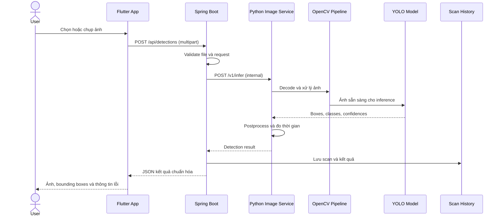

# Phase 1 - Pipeline tổng thể

## 1. Mục tiêu

Phase 1 thống nhất cách Python, Spring Boot và Flutter trao đổi dữ liệu trước khi phát triển từng phần. Kết quả cần đạt là một pipeline đủ rõ để các thành viên làm độc lập mà không thay đổi giao diện tích hợp liên tục.

Phạm vi của phase này:

- Xác định luồng inference và luồng training riêng biệt.
- Xác định trách nhiệm, input và output của từng thành phần.
- Chốt định dạng kết quả phát hiện.
- Chốt quy ước tọa độ bounding box.
- Đặt tiêu chí kiểm thử tích hợp tối thiểu.

Chưa thuộc Phase 1: huấn luyện YOLO, cài đặt thuật toán enhancement, database thật và giao diện hoàn chỉnh.

## 2. Pipeline inference



### Các bước chi tiết

| Bước | Thành phần | Input | Xử lý | Output |
|---|---|---|---|---|
| 1 | Flutter | Ảnh camera/gallery | Preview và upload | Multipart image |
| 2 | Spring Boot | Multipart image | Kiểm tra loại file, dung lượng, ảnh hợp lệ | Request nội bộ hợp lệ |
| 3 | Python/OpenCV | Bytes ảnh | Decode, định hướng, enhancement được cấu hình | Ảnh cho model |
| 4 | YOLO | Ảnh đã xử lý | Detection | Box, class, confidence thô |
| 5 | Python | Kết quả thô | Lọc confidence, NMS/postprocess, timing | Detection result |
| 6 | Spring Boot | Detection result | Chuẩn hóa, lưu scan/history | Public API response |
| 7 | Flutter | JSON response | Scale và vẽ box đúng không gian tọa độ | Màn hình kết quả |

### Thứ tự xử lý ảnh ban đầu

```text
Image bytes
  -> Decode
  -> Fix orientation
  -> Geometric correction (tùy chọn)
  -> Illumination/color correction (tùy chọn)
  -> Resize/letterbox theo model
  -> Normalize theo model
  -> YOLO inference
  -> Postprocess
```

Mỗi enhancement là tùy chọn và phải có thực nghiệm trước/sau. Không mặc định rằng ảnh nhìn đẹp hơn sẽ làm YOLO tốt hơn.

## 3. Pipeline training

Training tách khỏi inference để tránh đưa augmentation ngẫu nhiên vào ảnh người dùng:

```text
Dataset đã gán nhãn
  -> Train/validation/test split
  -> Training augmentation
  -> Pretrained YOLO
  -> Fine-tuning
  -> Evaluation
  -> Export model artifact
  -> Python inference service
```

- Augmentation chỉ dùng khi training.
- Inference preprocessing phải ổn định và tái lập được.
- Model artifact do TV2/nhóm AI bàn giao cho Python service qua một đường dẫn cấu hình, không hard-code trong source.

## 4. Trách nhiệm và phụ thuộc

| Nhóm/phần | Trách nhiệm chính | Nhận vào | Bàn giao |
|---|---|---|---|
| TV1 | Preprocessing baseline, classification và đánh giá ảnh | Dataset/ảnh | Quy tắc preprocessing, classifier, metrics |
| TV2 | Detection, YOLO, camera và annotation | Dataset gán nhãn | Model artifact, class map, ngưỡng baseline |
| TV3 - Python | Enhancement, model integration, inference timing | Ảnh + model TV2 | Kết quả theo contract |
| TV3 - Spring Boot | Public API, validation, orchestration, history | Upload từ app | JSON ổn định cho Flutter |
| TV3 - Flutter | Capture/upload, result overlay, history | API response | Trải nghiệm demo hoàn chỉnh |

Phụ thuộc quan trọng:

- Python cần từ TV2: file model, phiên bản YOLO, danh sách class và kích thước input.
- Spring Boot chỉ phụ thuộc contract, không phụ thuộc trực tiếp thư viện YOLO.
- Flutter chỉ gọi Spring Boot, không gọi Python trực tiếp.
- TV1/TV3 phải thống nhất preprocessing để tránh xử lý lặp hoặc mâu thuẫn.

## 5. Hợp đồng API

### Public API cho Flutter

```http
POST /api/detections
Content-Type: multipart/form-data

image=<binary>
```

Ví dụ response thành công:

```json
{
  "scanId": "81f59d2d-9b93-4f5e-a18b-b5a34178ad18",
  "success": true,
  "hasDefect": true,
  "sourceImage": {
    "width": 1280,
    "height": 720
  },
  "displayImage": {
    "url": "/api/scans/81f59d2d-9b93-4f5e-a18b-b5a34178ad18/image",
    "width": 1280,
    "height": 720,
    "coordinateSpace": "processed"
  },
  "processing": {
    "preprocessingMs": 12.4,
    "inferenceMs": 54.8,
    "postprocessingMs": 4.1,
    "totalMs": 71.3
  },
  "detections": [
    {
      "class": "scratch",
      "confidence": 0.91,
      "x1": 120,
      "y1": 80,
      "x2": 300,
      "y2": 180
    }
  ]
}
```

JSON Schema chính thức nằm tại `contracts/detection-result.schema.json`.

### Error response

```json
{
  "success": false,
  "error": {
    "code": "INVALID_IMAGE",
    "message": "File tải lên không phải ảnh hợp lệ"
  }
}
```

Các mã lỗi baseline: `EMPTY_FILE`, `UNSUPPORTED_FILE_TYPE`, `FILE_TOO_LARGE`, `INVALID_IMAGE`, `INFERENCE_UNAVAILABLE`, `INTERNAL_ERROR`.

## 6. Quy ước bounding box

- Tọa độ dùng pixel, gốc `(0, 0)` ở góc trên trái.
- `x1, y1` là góc trên trái; `x2, y2` là góc dưới phải.
- Box phải thỏa `0 <= x1 < x2 <= width` và `0 <= y1 < y2 <= height`.
- Bounding box luôn ứng với kích thước trong `displayImage`.
- `coordinateSpace = processed` nghĩa là Flutter phải vẽ box lên ảnh `displayImage.url`, không vẽ lên ảnh nguồn.

Quy ước này đặc biệt quan trọng khi áp dụng Perspective Correction vì hình học của ảnh đã thay đổi. Ở các phase chưa có biến đổi hình học, ảnh hiển thị có thể giống ảnh nguồn nhưng contract vẫn giữ nguyên.

## 7. Dữ liệu lịch sử quét tối thiểu

Một scan cần lưu:

- `scanId`, thời gian tạo và trạng thái xử lý.
- Tham chiếu ảnh nguồn và ảnh hiển thị.
- `hasDefect`, tổng số lỗi và danh sách detection.
- Phiên bản model và cấu hình enhancement.
- Thời gian preprocessing, inference, postprocessing và tổng thời gian.

Không lưu ảnh dưới dạng Base64 trong database. Database chỉ lưu đường dẫn hoặc URL; file ảnh được lưu riêng.

## 8. Tiêu chí hoàn thành Phase 1

- Cả ba thành phần dùng cùng tên trường và kiểu dữ liệu trong contract.
- Flutter biết box đang thuộc ảnh nào và kích thước nào.
- Spring Boot có một public endpoint duy nhất cho luồng detection.
- Python có một internal endpoint duy nhất cho inference.
- Training augmentation không xuất hiện trong inference pipeline.
- Mỗi phase enhancement sau này phải ghi lại before/after, thời gian xử lý và ảnh hưởng tới detection.

## 9. Kịch bản kiểm thử tích hợp baseline

1. Upload một ảnh hợp lệ và nhận response có `scanId`.
2. Upload file không phải ảnh và nhận `INVALID_IMAGE` hoặc `UNSUPPORTED_FILE_TYPE`.
3. Ảnh không có lỗi trả `hasDefect=false` và `detections=[]`.
4. Ảnh có lỗi trả box nằm trong kích thước `displayImage`.
5. Python tạm ngừng thì Spring Boot trả `INFERENCE_UNAVAILABLE`, không làm ứng dụng treo.
6. Tổng thời gian gần bằng tổng các bước và được ghi vào lịch sử.

## 10. Quyết định cho prototype 6 tuần

- Giao tiếp Spring Boot - Python bằng HTTP nội bộ vì dễ chạy, kiểm thử và trình bày.
- Chỉ Flutter gọi Spring Boot để giữ một cổng API thống nhất.
- Bắt đầu với lưu file cục bộ và database nhẹ; chỉ thay đổi khi có nhu cầu thật.
- Enhancement được bật/tắt bằng cấu hình để có thể so sánh baseline với phương pháp mới.
- Ưu tiên một model hoạt động ổn định trước khi tối ưu ONNX/quantization.
